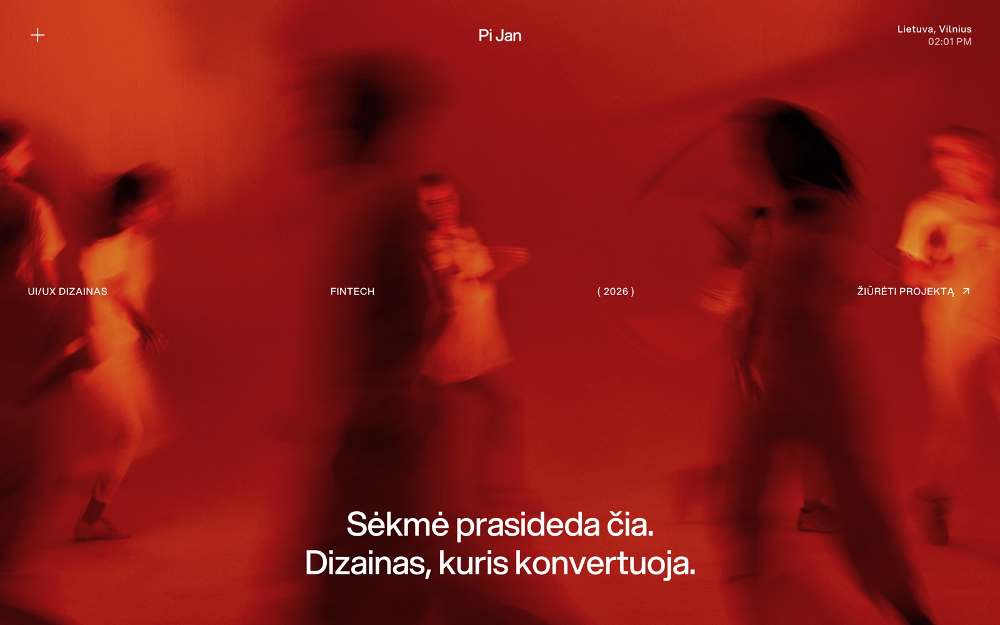
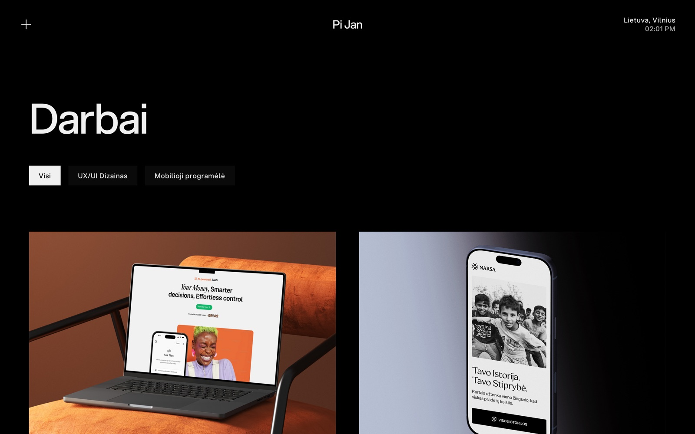
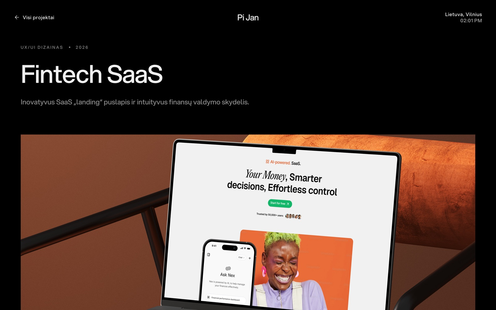

# Pi Jan: portfolio website

My design portfolio, built as a university project at VILNIUS TECH in spring 2026. The site's content is in Lithuanian.

**Live:** https://portfolio-ten-gamma-isw5twpoqa.vercel.app



## What's in it

- **Preloader:** the logo animates in, then travels into its place in the header.
- **Home:** a full-screen hero, an about section and a contact section, revealed on scroll with IntersectionObserver.
- **Projects:** a projects page with category filters and a detail page for each project (challenge, solution, role, year).
- **Header:** a live clock in Vilnius time and a menu.
- **Projects shown:**
  - *Fintech SaaS*: a landing page and finance dashboard (UX/UI, 2026)
  - *Narsa*: a wellbeing app for mental health and personal stories (mobile app, 2025)

| Projects page | Project page | Mobile |
|---|---|---|
|  |  |  |

## Built with

React 19 (Create React App) · React Router 7 · Bootstrap 5 · CSS animations · Aspekta typeface · Vercel

All project data lives in one file, `src/data/projects.js`. The projects page, the filters and every detail page are generated from it.

## Run it locally

```bash
npm install
npm start        # http://localhost:3000
npm run build    # production build in build/
```

`vercel.json` sends every path to `index.html`, so routes like `/projects/narsa` also work when opened directly.
